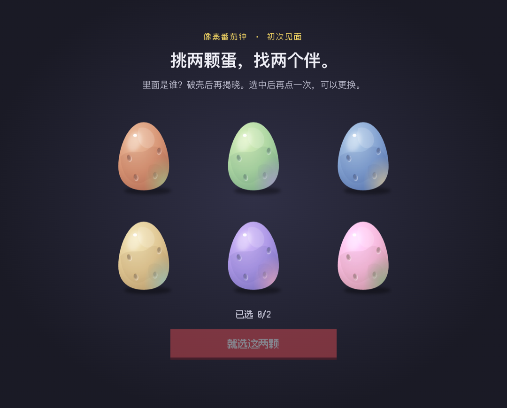
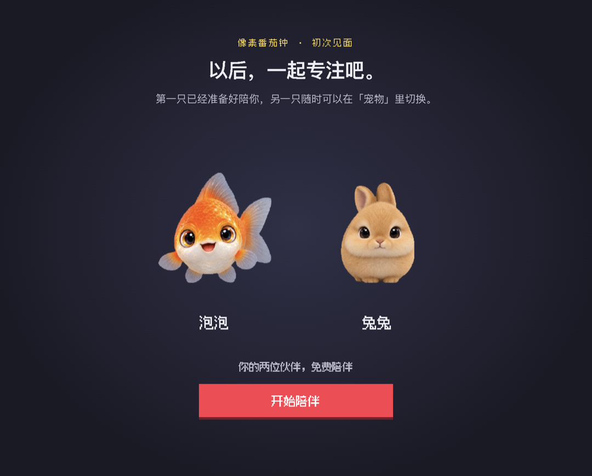
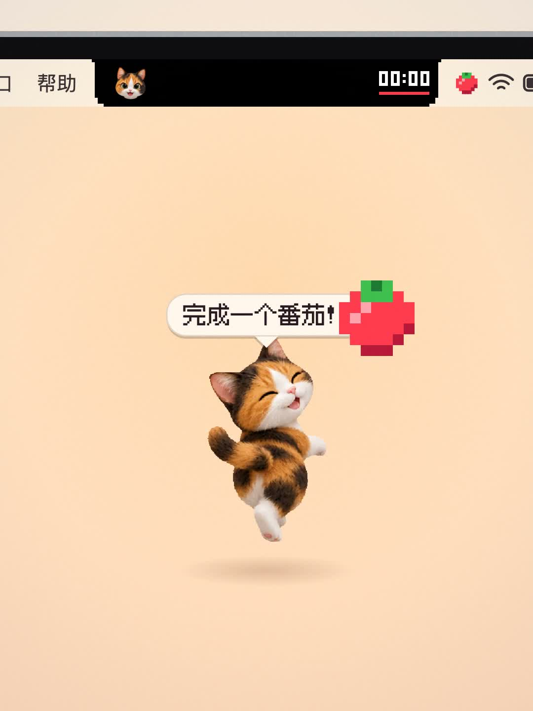
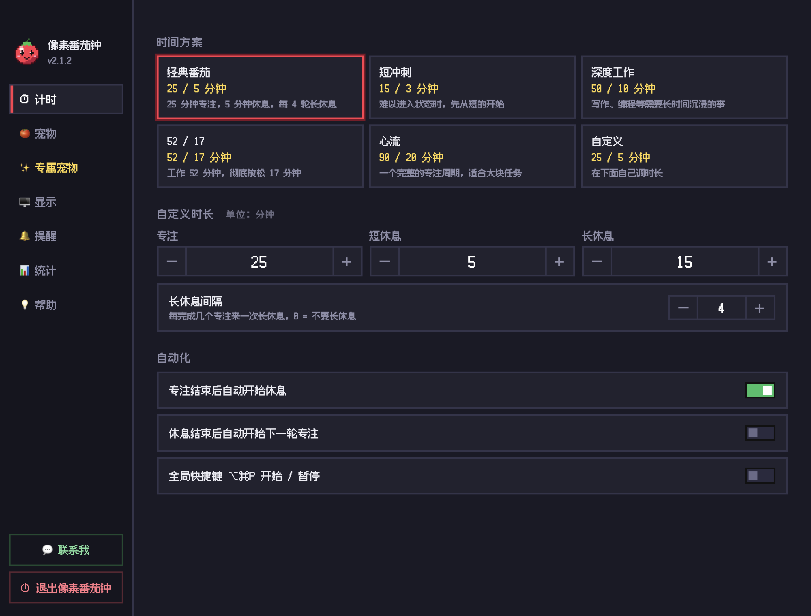
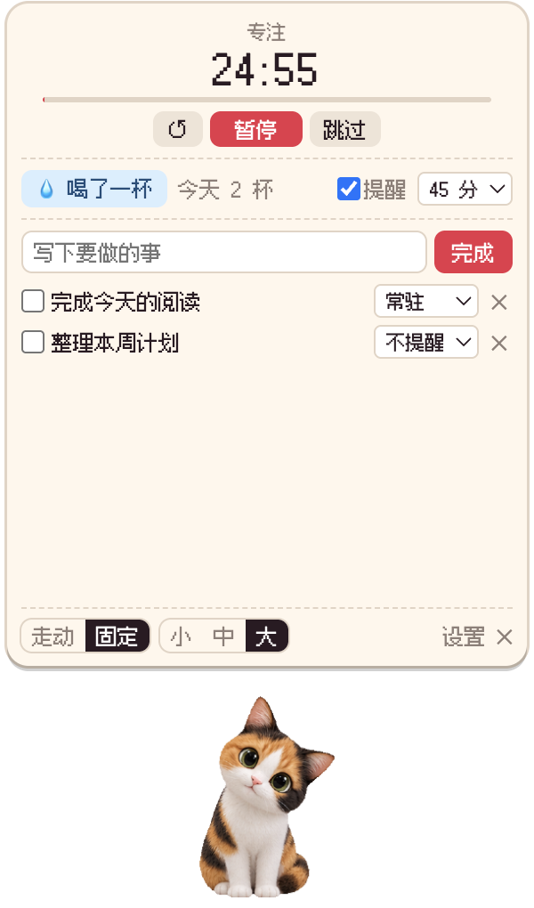
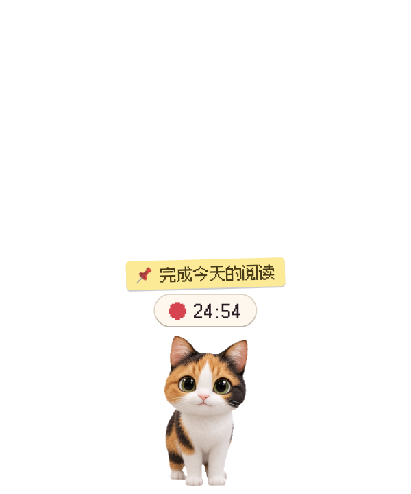
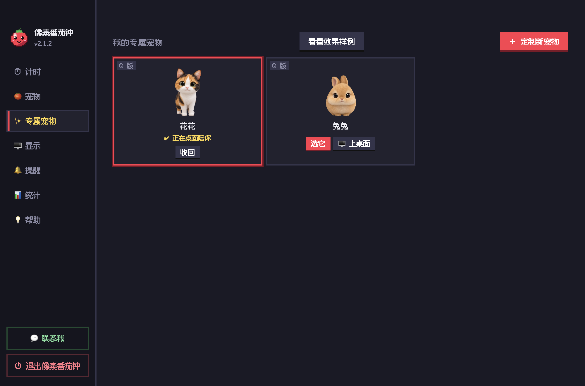
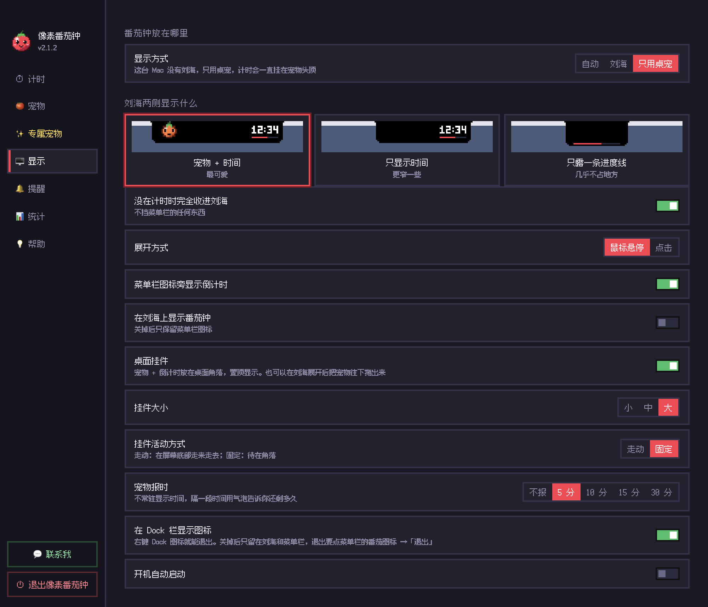
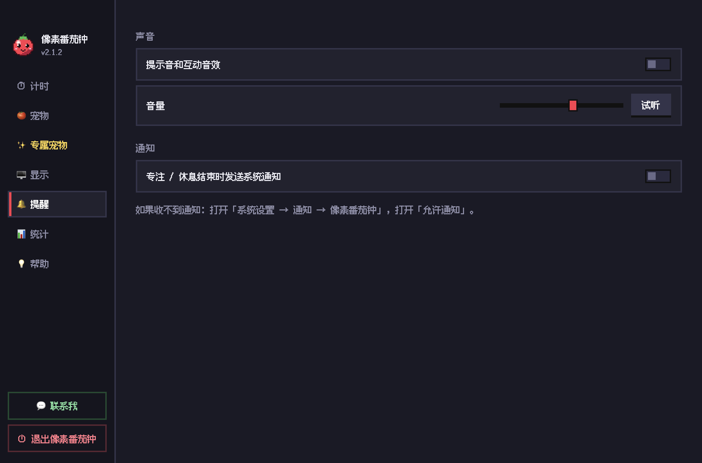
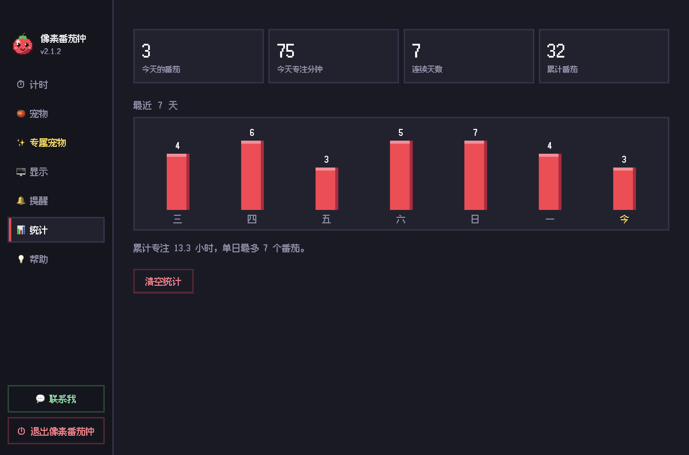

# 🍅 像素番茄钟

### 在 Mac 的刘海里，住进一只陪你专注的小伙伴。

番茄计时 · 桌宠陪伴 · 免费领养 · 照片定制

**[下载 Mac 安装包（v2.1.5 · M 芯片）](https://github.com/CHONGCHONGXC/pixel-pomodoro/releases/download/v2.1.5/pixel-pomodoro-2.1.5-mac-arm64.dmg)** · **[安装说明](docs/INSTALL.md)** · **[问题反馈](https://github.com/CHONGCHONGXC/pixel-pomodoro/issues)**

适用于 Apple 芯片（M 系列）Mac · 当前为内测版本

https://github.com/user-attachments/assets/88cf30d6-74c7-41cb-ae3f-24e1cc73db96

像素番茄钟把计时器放进 Mac 的刘海，让小伙伴陪你完成一个番茄。你也可以把它放到桌面上，看它走动、给你打气，提醒你该休息了。

没有刘海的 Mac，也可以用桌宠模式。

## 从两颗神秘蛋开始

第一次打开，从六颗神秘蛋里挑选两颗。等它们破壳，才知道迎接你的是谁。

约 7 秒，你就能拥有两只免费小伙伴，在应用里切换使用。不需要先激活专业版。

| 挑两颗蛋，找两个伴 | 以后，一起专注吧 |
| --- | --- |
|  |  |

*以上为 v2.1.2 实际应用截图。宠物在孵化后揭晓，图片中的组合仅为一次领养示例。*

## 它会怎么陪你

| 你在做什么 | 小伙伴怎么陪你 |
| --- | --- |
| 开始一轮专注 | 刘海显示倒计时，小伙伴陪你进入状态 |
| 在桌面上工作 | 宠物可以走动，也可以固定在你喜欢的位置 |
| 想记住一件小事 | 记下待办，完成后打勾 |
| 坐得太久 | 用休息和喝水提醒，给自己留一点喘口气的时间 |
| 想看看今天的投入 | 在统计页查看专注记录 |
| 想让自己的宠物来陪你 | 专业版支持用照片生成专属宠物，可选 Q 版 3D 或像素风 |

*宣传片和上图为演示动画；下方为实际界面截图。*

## 看看实际界面

以下为 v2.1.2 运行中的真实应用截图。统计、待办和喝水记录使用演示数据，方便展示操作方式。

### 按自己的节奏，开始一轮专注

经典番茄、短冲刺、深度工作、52/17、心流，选一个适合今天的节奏；也可以自己调整专注、短休息和长休息时长。

### 倒计时、喝水和待办，都在小伙伴身边

打开桌宠面板就能暂停或跳过当前计时、记录喝水、添加待办。重要的事可以设为「常驻」，收起面板后继续挂在宠物头顶。

*桌宠截图保留透明背景；图中的待办和喝水次数为演示内容。*

### 今天，让谁陪你？

在宠物页切换已经领养的小伙伴，把它放到桌面，或收回。这里展示的是一次实际领养获得的花花和兔兔。

*图中「定制新宠物」入口属于专业版；首次免费领养的两只宠物无需专业版即可使用。*

### 刘海还是桌面，由你决定

可以选择显示方式、桌宠大小、走动或固定，还能调整报时间隔、Dock 图标和开机启动。

### 提醒的声音，也可以轻一点

按自己的习惯开关提示音、调节音量，以及设置系统通知。

### 看见一点点积累

今天完成了几个番茄、专注了多久、连续坚持了几天，以及最近一周的投入，都可以在统计页查看。

*此处的番茄数量、专注时长和七天记录均为演示数据，不代表实际使用成果。*

## 免费使用与专业版

先领养，再开始专注。需要照片定制时，再了解专业版。

| 内容 | 免费使用 | 专业版 |
| --- | :---: | :---: |
| 番茄计时、休息提醒与专注统计 | ✓ | ✓ |
| 首次从六颗蛋中免费领取两只宠物 | ✓ | ✓ |
| 已领养宠物的切换、改名与陪伴 | ✓ | ✓ |
| 照片生成专属宠物 | — | ✓，受激活码额度限制 |
| 定制时选择 Q 版 3D / 像素风 | — | ✓ |

照片定制需要联网，生成效果因照片而异。专业版通过激活码解锁，具体获取方式与额度请在应用内点击 **「联系我」** 了解。升级不会自动解锁首次未选择的其余四颗蛋。

## 下载与安装

1. 打开 **[Releases 下载页](https://github.com/CHONGCHONGXC/pixel-pomodoro/releases)**。
2. 在对应版本的 **Assets** 中下载 M 芯片版 `.dmg` 文件。
3. 打开 DMG，将「像素番茄钟」拖入「应用程序」。
4. 启动应用，领养小伙伴，跟随教学开始使用。

**无需安装开发工具。** GitHub 的绿色 `Code` 按钮和 `Source code` 压缩包都不是应用安装包。

首次打开遇到 macOS 安全提示，请看 **[完整安装说明](docs/INSTALL.md)**。

## 常见问题

**我的 Mac 没有刘海，可以用吗？**  
可以，使用桌宠模式即可。目前公开提供的安装包面向 Apple 芯片 Mac。

**支持 Intel Mac 或 Windows 吗？**  
当前下载页仅提供 M 芯片 Mac 版本，其他平台尚未提供经过验证的安装包。

**必须付费才能养宠物吗？**  
不用。新用户首次免费领养的两只宠物可以直接使用，照片定制属于专业版功能。

**是不是所有功能都离线运行？**  
基础计时和已有宠物陪伴可在本机运行。照片生成、专业版激活与授权复查需要联网；专业版不支持永久离线使用。内测阶段，部分网络环境可能无法连接在线服务。

**怎么更新？**  
可以在应用帮助页检查更新，下载完成后选择「重启并更新」。也可以到 Releases 下载新版安装包，退出应用后替换安装；若在线更新连接失败，请使用安装包。

**照片会发到哪里？**  
照片定制使用在线生成服务，提交的照片会发送到相应服务进行处理。请使用你有权使用的照片，避免提交敏感内容。

## 反馈与建议

遇到问题或有想法，欢迎到 **[Issues](https://github.com/CHONGCHONGXC/pixel-pomodoro/issues)** 留言。提交时注明应用版本、macOS 版本、芯片型号，以及发生了什么。

请不要公开激活码或私人照片。激活与额度问题可以通过应用内「联系我」反馈。

## 关于这个仓库

这是像素番茄钟的**产品介绍、安装包发布与反馈仓库**。应用为闭源软件，本仓库不提供应用源码。

第三方素材保留各自许可，见 [素材署名](docs/CREDITS.md)。

